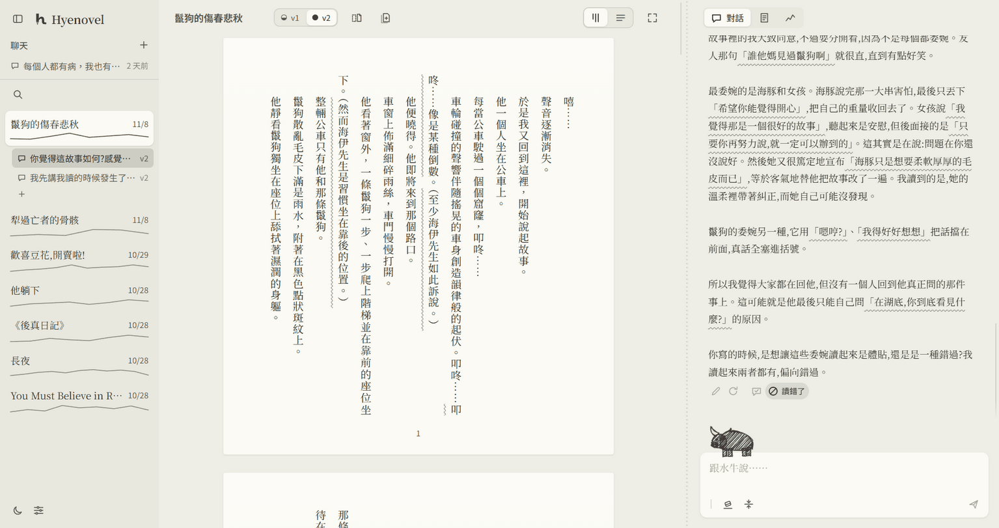
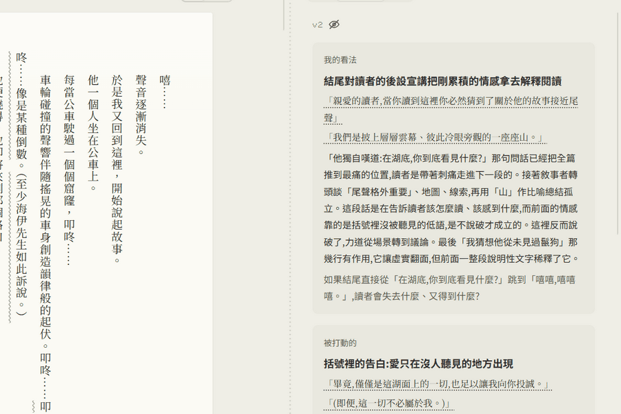
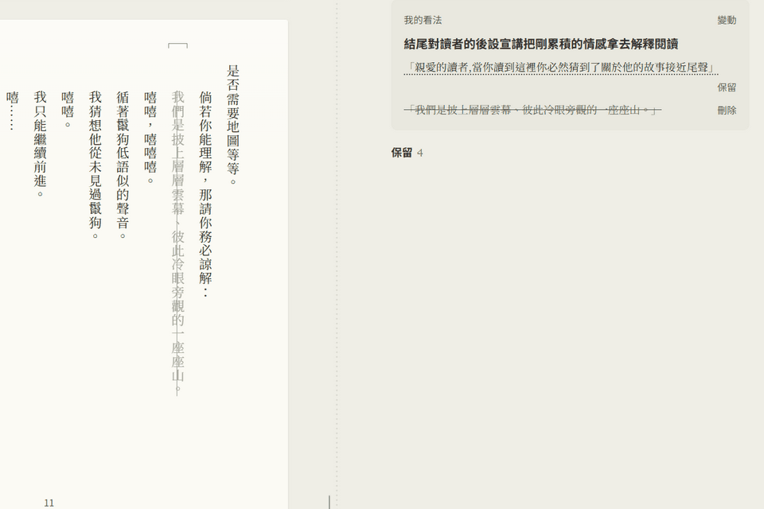
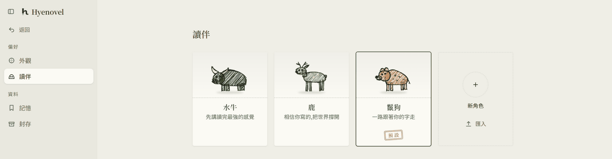

<div align="center">


<br>


[繁體中文](README.md) · **English**

</div>

> Hyenovel is a reading and discussion tool for literary short fiction written in Chinese and Taiwanese vernacular. It runs on [Claude Code](https://claude.com/claude-code) and uses the author's own subscription, with no separate per-token API charges.

## Overview

The tool is intended for literary short fiction of up to 10,000 characters. After the author submits a work, a reading companion reads it in full and discusses it with the author over multiple turns: the companion describes what it read and where it was uncertain, and asks about the author's intentions. The companion does not assign scores and does not rewrite the draft.

Once a work is submitted, two isolated steps run in the background. The first step performs **observation** only, identifying themes, motifs, techniques, effects, characters, and beats. The second step acts as a **neutral reader** and records its responses and judgments as notes ranked by importance. The two steps run in separate contexts so that the judgment is not shaped by the observation process. Every claim must cite **verbatim text** from the source; a citation gate checks each quotation against the original and rejects any that cannot be matched.

## Interface

**Work page**: the draft appears on the left (vertical text by default) and the conversation with the companion on the right. Sentences the companion quotes are marked on the draft with a pencil-style wavy underline.



**Notes**: the neutral reader's notes, each with source quotations and a question. The Structure tab in the same panel shows the tension curve and motif distribution.



**Version comparison**: after a new version is submitted, the comparison view shows the draft as a marked-up proof with deleted text struck through. The right panel lists, for each note on the previous version, whether its quoted sentences were kept, changed, or deleted.



**Companions**: three built-in companions (water buffalo, deer, and hyena), each with its own way of reading. Users can also create new companions or import character cards.



## Features

- **Submission and analysis**: drag in or paste a .md / .txt draft. Analysis runs in the background, the current step is shown above the draft, and it can be stopped at any time.
- **Discussion with the companion**: each reply can be regenerated, edited directly, or marked "Sounds like it" to serve as a voice example in later conversations. Sentences from the draft can be quoted in the conversation.
- **Notes and structure**: notes are ranked by importance and anchored to the source; the structure view shows the chain of intent (technique → effect → theme) and the tension of the text.
- **Versions and comparison**: new versions of a work can be submitted at any time, optionally saved without analysis. When comparison is open, the companion also receives the changes.
- **Memory**: press "Remember" in a conversation (on a whole reply or a selected passage), to save it. Memories about the author apply to every conversation; memories about a work apply only to conversations about that work. Memories can be viewed, edited, and archived in Settings.
- **Unbound conversations**: conversations do not require a work; a draft added during such a conversation can later be turned into a work.
- **Companion creation**: after two questions (the companion's form and how it reads), the system generates three candidates; the chosen one can then be adjusted. Character cards use the Character Card V3 format and can be imported and exported.
- **Claude Code integration**: through MCP, works can be submitted and discussed from a Claude Code session in any directory.
- **Export**: analysis and notes can be exported as Markdown and a standalone HTML file.

## Compared with a typical AI review

| Aspect | Hyenovel | Typical AI review |
|---|---|---|
| **Observation and judgment** | Two isolated steps: observation first, then judgment | One model writes everything at once, so observation is colored by judgment |
| **Citations** | Every claim cites verbatim text, checked by a citation gate; unmatched citations are rejected | Often summarizes from impression and is hard to trace back to the text |
| **Billing** | Runs on Claude Code using subscription usage, with no separate per-token charges | Billed per API token |
| **Privacy** | Runs locally for a single user; drafts are sent to Anthropic through the author's own Claude Code and stored in a local database, with no third-party service involved | Drafts are uploaded to third-party websites |
| **Interaction** | Multi-turn discussion of the same work, continuing across new versions; companions can be switched or created | A one-time summary |

## Installation

### Requirements

| Requirement | How to install |
|---|---|
| Claude Code (signed in, with a subscription) | See [claude.com/claude-code](https://claude.com/claude-code); after installing, run `claude` once to sign in |
| git | Install with the system package manager, e.g. `sudo apt install git` |
| Python 3.12 or later, and uv | See the [uv installation guide](https://docs.astral.sh/uv/getting-started/installation/); uv downloads the required Python version automatically |
| Node.js 22 | Install [nvm](https://github.com/nvm-sh/nvm), then run `nvm install` in the project directory (uses `.nvmrc`) |

Platforms: verified on Linux and WSL; not yet verified on macOS; on Windows, run it inside WSL.

### Steps

```bash
git clone https://github.com/randyxu0711/hyenovel.git
cd hyenovel

uv venv --python 3.14
uv pip install -r pyproject.toml

cd web && npm install && npm run build && cd ..
```

## Usage

### Starting

```bash
.venv/bin/python -m den.open
```

This command ensures that the background service, den, is running, obtains a one-time sign-in code, and opens the dashboard in a browser. If no browser opens (common under WSL), open the printed URL manually; the code is valid for 120 seconds. den exits on its own after 3 hours of inactivity and starts again the next time `den.open` is run.

### First use

1. Run `den.open` to open the dashboard.
2. Drag a .md / .txt draft onto the page, or paste it. The draft is first added to the conversation, so the companion can read and discuss it right away.
3. Press "Make it a work", then press "Analyze" on the work page. While analysis runs, the current step is shown above the draft.
4. When analysis is complete, discuss the work with the companion in the right panel, or open the notes and structure views.
5. After revising, press "New version" (or drag the new file onto the work page), then open the comparison to review the changes.

### In Claude Code

First register the MCP server (replace the path with your clone location):

```bash
claude mcp add hyenovel -- <path to your clone>/.venv/bin/python -m den.mcp
# or, from inside the project directory:
claude mcp add hyenovel -- "$(pwd)/.venv/bin/python" -m den.mcp
```

After registration, the following commands are available in Claude Code from any directory:

- `/hyenovel:companion`: start a discussion. Provide a .md / .txt path to submit a work, or discuss the most recent one.
- `/hyenovel:continue`: continue the discussion of the most recent work.

Other operations can be requested in plain language, for example "list my works" or "show the notes for the sea story". The available tools are:

| tool | Purpose |
|---|---|
| `submit_work` | Submit a work (.md / .txt path), or resume an unfinished analysis |
| `talk_to_companion` | Talk to the companion |
| `find_works` | List works and their analysis status |
| `read_work` | Read the source text, analysis, or notes |
| `cancel_work` | Stop an analysis |
| `list_characters` | List the available companions |
| `set_character` | Change the companion for the current conversation |
| `create_character` | Generate candidates for a new companion |
| `save_character` | Save the chosen candidate |
| `manage_chat` | Clear or compact the conversation, or turn a draft in the conversation into a work |

### Export

```bash
.venv/bin/python -m export <slug> [--out DIR]
```

This writes `<slug>.md` (notes and analysis) and `<slug>.html` (chain of intent and text axis). `<slug>` is the work's identifier, available from `find_works` or the dashboard URL (`/w/<slug>`).

### Updating

```bash
git pull
uv pip install -r pyproject.toml
cd web && npm install && npm run build && cd ..
```

Then run `/mcp` in Claude Code to reconnect to hyenovel. den restarts automatically when it detects a new version; if an analysis is running, it waits for the analysis to finish first.

### Data location

All data is stored in `~/.local/share/hyenovel/` (or `$XDG_DATA_HOME/hyenovel/` if `XDG_DATA_HOME` is set; `HYENOVEL_DATA_DIR` can also be used to choose a location):

- `hyenovel.db`: works, analyses, notes, conversations, memories, and companions.
- `den.token`, `den.json`: connection details for den.

To back up, copy `hyenovel.db`. While den is running, `sqlite3 hyenovel.db ".backup backup.db"` is the safer option.

## Development

```bash
./dev.sh                         # ensure den is running and start the frontend dev server (http://localhost:5173)
.venv/bin/python -m pytest       # run the tests (requires uv pip install -r requirements-dev.txt first)
```

## How it works

```
submit (dashboard / submit_work) ─▶ den ─ analyst ▶ reviewer ─▶ SQLite (observation + judgment)
                                                                       │
                         ┌─────────────────────┬───────────────────────┤
                         ▼                     ▼                       ▼
                 dashboard (reads den)   companion (dashboard / MCP)   python -m export ─▶ md + html
```

The analyst (observation) and the reviewer (judgment) run in separate contexts. Discussion with the companion can begin as soon as observation is complete, without waiting for the notes. The companion receives only the source text, a condensed analysis, and the categories and quotations of the notes; it **does not see the content of the notes**, which keeps its reading independent.
