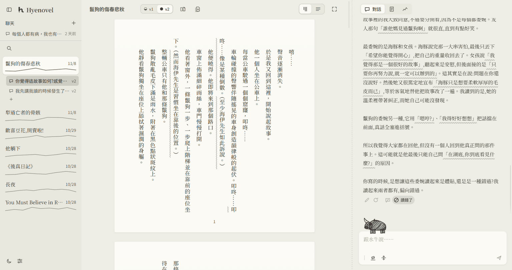
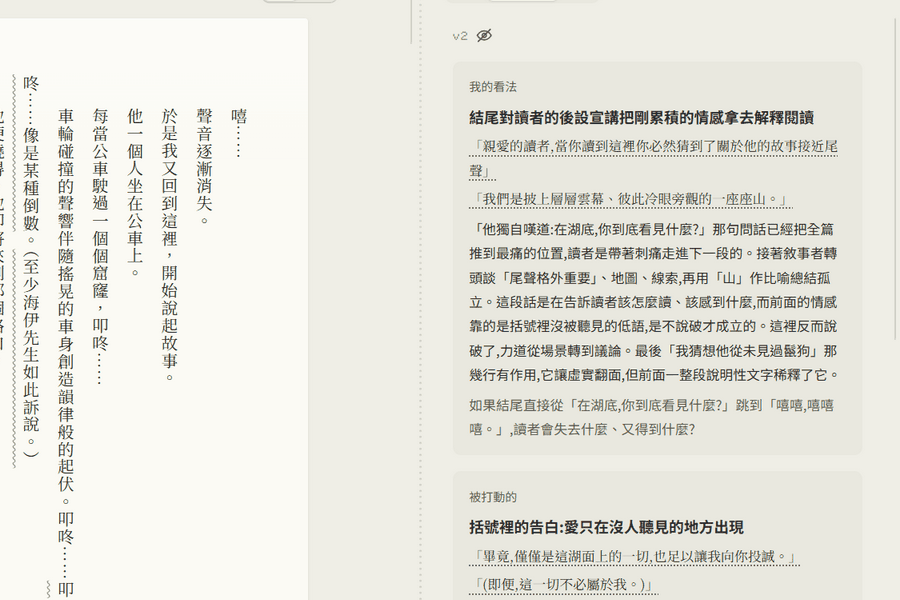
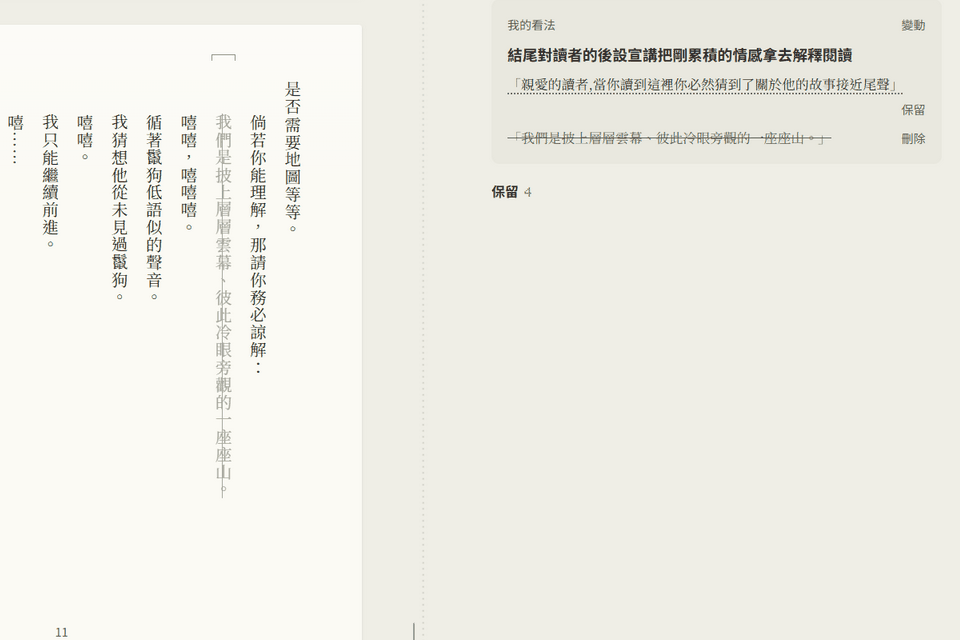
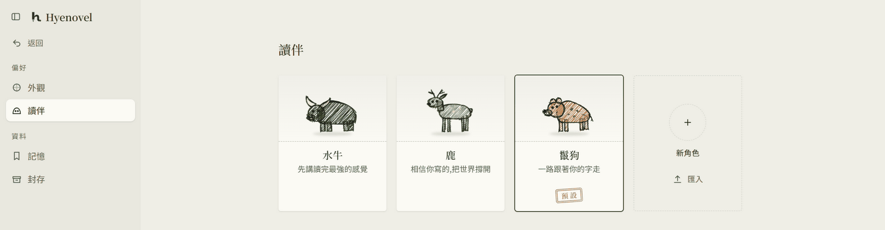
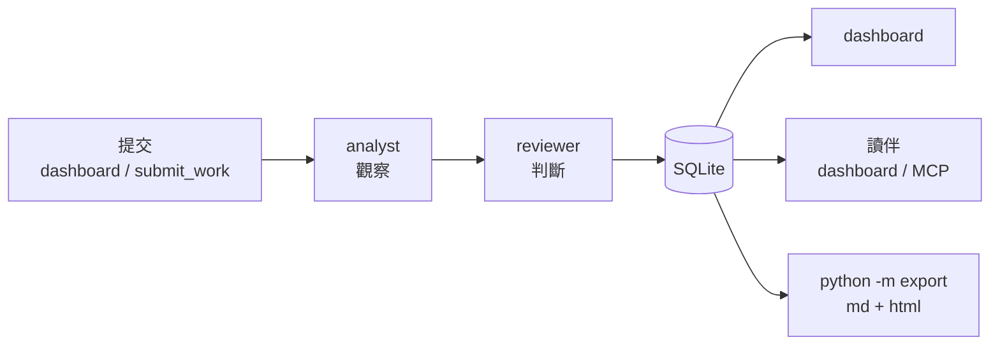

<div align="center">


<br>


**繁體中文** · [English](README.en.md)

</div>

<p align="center"><b>為純文學短篇設計的閱讀與討論工具。</b><br>
在 <a href="https://claude.com/claude-code">Claude Code</a> 上執行，使用作者本人的訂閱額度，不另按 API token 計費。</p>

## 核心特點

- **讀伴對話**：讀伴閱讀全文後與作者多輪討論，說明讀到的內容與困惑之處，並詢問寫作時的考量。讀伴不評分，也不代替作者修改稿件。
- **觀察與判斷分離**：分析拆為兩個在獨立 context 中執行的步驟——先觀察結構，再由中性讀者寫下判斷，判斷不受觀察過程影響。
- **逐字引用**：每一項主張皆須附上原文，引用閘門逐條比對，無法對應的引用一律阻擋。

適用篇幅為一萬字以內的短篇。

## 介面



**作品頁**：左側顯示稿件（預設為直排），右側為與讀伴的對話。讀伴引用到的句子，會在稿上以鉛筆波浪線標示。

| 筆記 | 版本對照 | 讀伴設定 |
|:---:|:---:|:---:|
|  |  |  |
| 中性讀者的筆記，每條附原文引句與一個提問 | 校對稿，右欄列出上一版筆記引句的去向 | 內建水牛、鹿、鬣狗，可建立或匯入角色 |

## 功能

- **提交與分析**：支援拖曳或貼上 .md / .txt 稿件。分析在背景執行，稿件上方顯示目前步驟，可隨時停止。
- **與讀伴討論**：每則回覆皆可重新生成、直接編輯，或標記為「像它」，作為之後對話的語氣範例。對話中可引用稿件中的句子。
- **筆記與結構圖**：筆記依重要性排序，每條皆錨定原文；結構圖呈現意圖鏈（技法 → 效果 → 主題）與文本張力。
- **版本管理與對照**：同一篇作品可持續提交新版本，並可選擇只儲存、暫不分析。開啟對照時，讀伴也會讀到本次修改的內容。
- **記憶**：在對話中按「記住」（整則或選取的段落），即可保存。關於作者的記憶在所有對話中生效，關於作品的記憶只在該作品的對話中生效。記憶可在設定頁檢視、編輯與封存。
- **不綁作品的對話**：可以不指定作品直接對話；對話中加入的稿件，之後可以轉為正式作品。
- **角色**：回答兩個問題（角色的形體與閱讀方式）後，系統生成三個候選角色，選定後可再調整。角色卡採用 Character Card V3 格式，支援匯入與匯出。
- **Claude Code 整合**：透過 MCP，可在任一目錄的 Claude Code session 中提交作品、與讀伴討論。
- **匯出**：將分析與筆記匯出為 Markdown 與獨立的 HTML 檔。

## 與一般 AI 讀後感的差異

| 面向 | Hyenovel | 一般 AI 讀後感 |
|---|---|---|
| **觀察與判斷** | 兩個隔離的步驟，先觀察、後判斷 | 單一模型一次寫完，觀察容易受判斷影響 |
| **引用** | 每項主張附逐字原文，經引用閘門比對，無法對應即阻擋 | 多憑印象概括，不易回溯原文 |
| **計費** | 在 Claude Code 上執行，使用訂閱額度，不另按 token 計費 | 依 API token 計費 |
| **隱私** | 僅在本機執行、單人使用；稿件經作者本人的 Claude Code 送交 Anthropic 處理，資料存放於本機資料庫，不經第三方服務 | 稿件上傳至第三方網站 |
| **互動** | 可就同一篇作品多輪討論、提交新版本後繼續討論；讀伴可更換、可自行建立 | 一次性的綜合評述 |

## 安裝

### 系統需求

| 項目 | 安裝方式 |
|---|---|
| Claude Code（已登入且有訂閱） | 見 [claude.com/claude-code](https://claude.com/claude-code)；安裝後執行 `claude` 完成登入 |
| git | 使用系統套件管理器安裝，例如 `sudo apt install git` |
| Python 3.12 以上與 uv | 見 [uv 安裝說明](https://docs.astral.sh/uv/getting-started/installation/);uv 會自動下載所需的 Python 版本 |
| Node.js 22 | 安裝 [nvm](https://github.com/nvm-sh/nvm) 後，在專案目錄執行 `nvm install`（依 `.nvmrc` 安裝） |

支援平台：Linux 與 WSL 已驗證；macOS 尚未驗證；Windows 使用者請在 WSL 中執行。

### 安裝步驟

```bash
git clone https://github.com/randyxu0711/hyenovel.git
cd hyenovel

uv venv --python 3.14
uv pip install -r pyproject.toml

cd web && npm install && npm run build && cd ..
```

## 使用方式

### 啟動

```bash
.venv/bin/python -m den.open
```

此指令會確認背景服務 den 已啟動，取得一次性的登入碼，並以瀏覽器開啟 dashboard。若無法自動開啟瀏覽器（WSL 環境常見），請手動開啟指令輸出的網址；登入碼的有效時間為 120 秒。den 閒置 3 小時後會自動結束，下次執行 `den.open` 時會重新啟動。

### 首次使用流程

1. 執行 `den.open`，開啟 dashboard。
2. 將 .md / .txt 稿件拖曳至畫面，或直接貼上。稿件會先加入對話，讀伴可以先行閱讀與討論。
3. 按「開成作品」，再於作品頁按「分析」。分析進行時，稿件上方會顯示目前步驟。
4. 分析完成後，可在右欄與讀伴討論，或檢視筆記與結構圖。
5. 修改稿件後按「交新版」（或將新檔案拖曳至作品頁），再開啟對照檢視修改內容。

### 在 Claude Code 中使用

首先註冊 MCP（請將路徑替換為 clone 的位置）:

```bash
claude mcp add hyenovel -- <clone 的路徑>/.venv/bin/python -m den.mcp
# 或在專案目錄中執行：
claude mcp add hyenovel -- "$(pwd)/.venv/bin/python" -m den.mcp
```

註冊後，可在任一目錄的 Claude Code 中使用以下指令：

- `/hyenovel:companion`:開始討論。可提供 .md / .txt 檔案路徑以提交作品，或直接討論最近的一篇。
- `/hyenovel:continue`:接續最近一篇作品的討論。

其他操作以自然語言提出即可，例如「列出我的作品」「顯示〈海〉的筆記」。

<details>
<summary>可用的 MCP tool</summary>

| tool | 用途 |
|---|---|
| `submit_work` | 提交作品（.md / .txt 路徑），或續跑未完成的分析 |
| `talk_to_companion` | 與讀伴對話 |
| `find_works` | 列出作品及其分析狀態 |
| `read_work` | 讀取原文、分析或筆記 |
| `cancel_work` | 停止分析 |
| `list_characters` | 列出可用的讀伴 |
| `set_character` | 更換本場對話的讀伴 |
| `create_character` | 生成新角色的候選 |
| `save_character` | 儲存選定的候選角色 |
| `manage_chat` | 清空或壓縮對話，或將對話中的稿件轉為作品 |

</details>

### 匯出

```bash
.venv/bin/python -m export <slug> [--out DIR]
```

輸出 `<slug>.md`（筆記與分析）與 `<slug>.html`（意圖鏈與文本軸）。`<slug>` 為作品代號，可透過 `find_works` 或 dashboard 網址（`/w/<slug>`）查詢。

### 更新

```bash
git pull
uv pip install -r pyproject.toml
cd web && npm install && npm run build && cd ..
```

完成後，在 Claude Code 中執行 `/mcp` 重新連線 hyenovel。den 偵測到版本變更時會自動重新啟動；若分析正在進行，會等待完成後再重啟。

### 資料位置

所有資料存放於 `~/.local/share/hyenovel/`（若設定了 `XDG_DATA_HOME`，則為 `$XDG_DATA_HOME/hyenovel/`；亦可透過 `HYENOVEL_DATA_DIR` 指定）:

- `hyenovel.db`:作品、分析、筆記、對話、記憶與角色。
- `den.token`、`den.json`:den 的連線資訊。

備份時複製 `hyenovel.db` 即可。den 執行期間，建議改用 `sqlite3 hyenovel.db ".backup backup.db"`。

## 開發

```bash
./dev.sh                         # 確認 den 已啟動，並啟動前端開發伺服器（http://localhost:5173）
.venv/bin/python -m pytest       # 執行測試（需先執行 uv pip install -r requirements-dev.txt）
```

## 運作原理



analyst（觀察）拆解出主題、意象、技法、效果、角色與節拍；reviewer（判斷）以中性讀者的角度記錄閱讀感受，整理為依重要性排序的筆記。兩者在各自獨立的 context 中執行。觀察完成後即可與讀伴討論，無須等待筆記。讀伴取得的資料僅限原文、精簡後的分析，以及筆記的類別與引句；讀伴**不會讀到筆記內文**，以維持其閱讀的獨立性。
